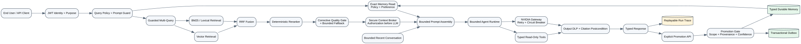

# Enterprise Governed Agentic AI — NVIDIA + LlamaIndex v6.4.4

Repository này nâng Agentic RAG demo thành một **production-oriented Enterprise Agentic AI
Reference Architecture** có policy enforcement, secure context store, strict grounding,
admission control, provider resilience và end-user response contract.

> LLM không sở hữu dữ liệu, không giữ database credential, không quyết định quyền truy cập và
> không được phép trả enterprise factual claim khi citation postcondition không đạt.


## v6.3 lakehouse gold read path (Delta Lake)

v6.3 nối service này với medallion lakehouse của repo `dcea_demo_environment_clean`
(raw -> bronze -> silver -> gold). API **chỉ đọc gold serving tables** qua delta-rs —
không nhúng Spark/JVM vào container, không cho LLM chạm SQL, bronze/silver không bao giờ
vượt qua AI boundary (ADR-020).

- **Typed capabilities** — `get_customer_order_summary_tool`, `get_book_sales_summary_tool`,
  `get_top_performers_tool` đi qua `analytics.read` policy (roles `analyst|operations|admin`,
  purposes `business-analytics|operations-review`) và tenant-declared warehouse ownership.
- **Versioned evidence** — mỗi observation cite đúng Delta commit version
  (`delta:<table>:<tenant>:<key>:v<version>`), snapshot pin theo TTL để một request luôn
  đọc nhất quán từ một commit.
- **DLP trước context** — tên khách hàng được pseudonymize/redact qua
  `DataMasker.mask_value` trước khi vào model context; aggregate và business key giữ nguyên.
- **Fail closed** — warehouse không đọc được trả `analytics_unavailable` với zero sources,
  không bao giờ đoán số.

Chạy local không cần Spark:

```bash
python scripts/seed_lakehouse_gold_demo.py
ANALYTICS_BACKEND=delta uvicorn nvidia_agentic_rag.api:app --port 8000
```

Hoặc nối với pipeline DCEA thật:

```bash
# Trong container DCEA
/workspace/scripts/run_business_demo.sh
/workspace/scripts/export_warehouse_for_api.sh
# Trên host, tại repo này
python scripts/sync_lakehouse_gold.py \
  --source <dcea>/workspace/databricks_associate_training/warehouse/dcea_medallion.db
# data/lakehouse/ đã được docker-compose mount read-only vào /app/data/lakehouse
```

Câu hỏi mẫu (purpose `business-analytics`, role `analyst`): "How much has customer C001
spent in total, and which book earns the most revenue?" — agent gọi hai typed tool, mỗi
factual claim mang citation `D…` trỏ về đúng Delta version.

## v6.2.1 live-latency hardening

The v6.2.1 patch is based on live c1/c2/c4/c8 evidence from the hosted NVIDIA path.
It keeps the v6.2 correctness/security architecture and hardens interactive latency:

- **Single retry owner** — chat SDK retries default to zero; runtime owns bounded retries.
- **Fast synthesis profile on by default** — single-corpus direct-RAG simple/comparison work
  uses reasoning-disabled synthesis with a smaller output cap; an alternate fast model remains optional.
- **30 s direct-RAG provider deadline** — prevents 60–120 s hosted-model tails.
- **Capacity fail-fast / tier downgrade** — no repeated retries against an exhausted fast tier;
  complex synthesis may downgrade before retrying the same tier.
- **Per-tier circuit breakers** — complex-tier saturation cannot open the fast-tier circuit.
- **Interactive admission defaults** — global queue wait is 3 s and overlapping same-session
  requests return `409 SESSION_BUSY` instead of serializing for up to two minutes.
- **Structured provider errors** — HTTP status and `Retry-After` are preferred over string matching.

## v6.2 governance deltas

Verified against the seventeen-point reference-architecture review
(`docs/GAP_MATRIX_V6_1_TO_V6_2.md`) and closed the four highest-value gaps:

- **Tiered model gateway** — optional fast NIM model for simple direct-RAG synthesis plus
  one-shot degrade-to-fast on transient exhaustion (ADR-018).
- **Per-tenant daily budgets** — request/token caps with 429 fail-closed and audit (ADR-019).
- **Opt-in cross-lane escalation** — empty-evidence direct RAG may try the bounded agent
  lane before the evidence gate fails closed (ADR-019; default off).
- **Symmetric security trimming** — vector candidates are authorization-filtered before
  RRF fusion, matching the lexical path, with a defensive rerank fallback.

Most governance features remain configuration-gated. v6.2.1 intentionally changes the
interactive defaults for tier routing, retries, queue wait, and same-session overlap because live
load evidence showed those defaults were the main remaining production bottlenecks.

## v6.1 production optimization

The runtime now uses three execution lanes instead of sending every request through an LLM agent:

- **Deterministic lane** — arithmetic and known public definitions execute without NVIDIA LLM calls.
- **Direct RAG lane** — explicit course/paper requests retrieve the selected corpus directly and use one grounded synthesis call. Explicit two-corpus requests retrieve both corpora and synthesize once.
- **Agent lane** — ambiguous, multi-step, or tool-dependent requests still use the bounded FunctionAgent/ReAct orchestration path.

Enterprise factual retrieval now fails closed when authorized candidates do not meet both relevance and query-coverage requirements. Multi-Query is adaptive and runs only for broad or ambiguous requests. These changes are designed to eliminate simple-route `AGENT_TOOL_BUDGET_EXCEEDED` failures and reduce provider latency while preserving the existing policy, citation, DLP, memory, trace, cache, and backpressure controls.

## What changed in v6

- Read path phân lớp: guarded Multi-Query -> vector + BM25 -> RRF -> rerank -> quality gate.
- Bounded corrective fallback có `degraded` marker và retrieval trace.
- Bounded recent conversation; workflow context mới mỗi request để chặn prompt tăng vô hạn.
- Typed durable memory: policy, preference, fact, episodic và trace.
- Hai memory path: exact enumeration cho policy/preference; discovery cho fact/episode.
- Server-side promotion gate; caller không được truyền `active` hoặc tự nâng scope.
- Auto-capture chỉ dành cho preference được nói rõ, theo allow-list deterministic; không suy diễn fact/personality/policy.
- Exact policy/preference overflow hoặc vượt prompt budget sẽ fail closed, không silently truncate.
- `model_inferred` fact vào `provisional`, cần admin approval mới active.
- Content-hash idempotency, SCD2 supersession, physical erasure và transactional outbox.
- Reference outbox dispatcher hỗ trợ at-least-once delivery; consumer deduplicate theo `event_id`.
- Replayable `run_id` trace với query/answer hash, source/tool/memory/retrieval metadata.
- Cache key thêm memory version; production bắt buộc PostgreSQL memory và trace.

## Stack

- LLM: `nvidia/nemotron-3-ultra-550b-a55b`
- Embedding: `nvidia/nv-embedqa-e5-v5`
- Orchestration: LlamaIndex `FunctionAgent` hoặc `ReActAgent`
- API: FastAPI
- Source of truth: PostgreSQL hoặc JSON fixture cho local test
- Derived context: persisted LlamaIndex vector indexes + BM25 lexical projection
- Durable memory: typed PostgreSQL tables, temporal lifecycle, RLS và outbox
- Authentication: JWT/OIDC-JWKS; development headers chỉ dùng local/test
- Authorization: deterministic RBAC + ABAC + purpose + clearance
- Audit/metrics: PostgreSQL/JSONL replay trace, PostgreSQL security audit và Prometheus

## Architecture



```text
Verified Identity + Purpose
  -> Query Policy + Prompt Guard
  -> Exact Policy/Preference Memory
  -> Guarded Multi-Query
  -> Vector + Lexical Retrieval
  -> RRF + Rerank + Corrective Quality Gate
  -> Secure Context Broker
  -> Bounded Conversation + Prompt Assembly
  -> Bounded Agent + Typed Tools + NVIDIA Resilience
  -> Output DLP + Strict Citation Postcondition
  -> Typed Response + Replay Trace
  -> Explicit/allow-listed Preference Promotion Gate -> Typed Durable Memory + Outbox
```

## Implemented controls

### Security and data

- JWT issuer/audience/signature/expiry verification.
- Tenant, role, department, clearance, purpose và authorization-version enforcement.
- Document security metadata bắt buộc trước ingestion.
- Retrieved candidates được authorization lại trước khi text vào LLM.
- Masking/pseudonymization và indirect prompt-injection inspection.
- Typed read-only operational tool; không có arbitrary SQL/shell/filesystem tool.
- PostgreSQL RLS cho operational records và document registry.
- Output DLP trước response.

### Grounding

- Current-turn source IDs `[Sxxxxxx]` / database IDs `[Dxxxxxx]`.
- Citation coverage tính theo factual sentence, bullet và Markdown table row.
- Không reuse citation cũ từ session memory.
- Strict mode không trả invalid answer.
- Conservative repair chỉ xóa uncited claim, không tự gắn citation.

### Reliability

- `SESSION_CONCURRENCY_POLICY=serialize|reject`.
- `CAPACITY_WAIT_TIMEOUT` trả 429 thay vì generic 504.
- NVIDIA retry/circuit breaker cho transient 429/502/503/504/network errors.
- Tool-call budgets với per-tool reuse limits cho calculator và typed analytics.
- Dynamic response budget theo query complexity.

### Observability

- `request_outcome`
- `latency_breakdown`
- `provider_trace`
- `tool_trace`
- `retrieval_traces`
- `memory_audit`
- `run_id`
- `policy_audit`
- `safety_audit`
- `citation_audit`
- Prometheus metrics cho stage latency, admission, provider retry/circuit và citation repair.


## v6.4.2 provider-context hardening

Nemotron-3-Ultra requests now use a provider-realistic context contract instead of the old
1,000,000-token client assumption. A stale environment value is capped to the managed endpoint
ceiling, an additional safety reserve is subtracted before the window is exposed to LlamaIndex,
and provider workflow state is request-scoped so session/tool history cannot grow without bound.

Implicit company-knowledge questions such as `Summarize our strategy ...` are routed through the
bounded local knowledge retrieval lane before synthesis. When authorized evidence is missing, the
enterprise factual gate fails closed rather than using model memory to invent company facts. See
`docs/V6_4_2_PROVIDER_CONTEXT_BUDGET_HARDENING.md`.

## v6.4.0 governed analytics hardening

Structured business analytics now uses a governed deterministic lane rather than sending ranking,
derived-metric, and reconciliation tasks through the complex NVIDIA model. The lane provides a
strict typed DSL, semantic metric/grain registry, row-level provenance, deterministic rendering,
answer-completeness validation, and tenant/Delta-version-safe cache admission. See
`docs/V6_4_0_GOVERNED_ANALYTICS_HARDENING.md`.

Key runtime semantics:

- `analytics_query_tool` is the generic structured Gold capability; no arbitrary SQL/formulas.
- `live_lakehouse_tool` vs `rag_vector_retrieval` distinguishes structured data from RAG.
- repaired or incomplete structured answers are rejected and never cached.
- deterministic analytics reports no NVIDIA provider invocation.
- production debug traces require `X-Debug-Trace: true` plus a privileged role.

## v6.3.1 analytics comparison hardening

Các câu hỏi business analytics kiểu “so sánh tổng chi tiêu của customer C001 với book có
revenue cao nhất, tính chênh lệch và phần trăm” không còn phụ thuộc vào việc agent gọi
`safe_calculator_tool` nhiều lần. Router có fast path deterministic tới
`compare_customer_spending_to_top_book_tool`, tool đọc đúng hai gold serving aggregates,
tính toán bằng `Decimal`, và trả lại hai database citations theo Delta version.

Fallback agent lane vẫn an toàn cho các câu hỏi analytics khác: global same-tool budget giữ ở
`1` cho retrieval/external tools, còn calculator và typed analytics có bounded reuse limit riêng.
Điều này tránh `AGENT_TOOL_BUDGET_EXCEEDED` giả đối với multi-step analytics nhưng vẫn chặn
loop/retry vô hạn.

## Local run

```bash
cp .env.example .env
# Điền NVIDIA_API_KEY mới. Không dùng key từng xuất hiện trong chat/log/source control.

docker compose build --no-cache
docker compose --profile tools run --rm ingest
docker compose up -d app

# Production: required secrets/URLs must be replaced before Compose renders.
docker compose -f docker-compose.yml -f docker-compose.production.yml config
docker compose -f docker-compose.yml -f docker-compose.production.yml up -d app
```

Khi port 8000 đang bị chiếm:

```dotenv
APP_PORT=8001
```

Health:

```bash
curl http://localhost:${APP_PORT:-8000}/health/live
curl http://localhost:${APP_PORT:-8000}/health/ready
```

## Public research request

```bash
curl -s http://localhost:8000/v1/chat \
  -H 'Content-Type: application/json' \
  -H 'X-User-Id: local-user' \
  -H 'X-Tenant-Id: public' \
  -H 'X-Clearance: public' \
  -d '{
    "query":"According to the indexed papers, what is eRAG and what computational benefit does it provide? Cite every quantitative claim.",
    "session_id":"erag-secure-001",
    "purpose":"research",
    "answer_mode":"enterprise_factual",
    "force_retrieval":true
  }'
```

## Response contract

```json
{
  "request_outcome": "success",
  "answer": "... [SABC123].",
  "latency_ms": 18200,
  "latency_breakdown": {
    "session_wait_ms": 0,
    "capacity_wait_ms": 1,
    "memory_write_ms": 3,
    "tool_ms": 650,
    "provider_ms": 17000,
    "citation_validation_ms": 4,
    "total_ms": 18200
  },
  "provider_trace": {
    "attempts": 1,
    "retry_count": 0,
    "circuit_state": "closed"
  },
  "memory_audit": {
    "enabled": true,
    "exact_record_count": 2,
    "semantic_record_count": 3,
    "write_candidate_count": 1,
    "write_accepted_count": 1
  },
  "retrieval_traces": [{
    "mode": "hybrid",
    "relevance": "high",
    "degraded": false
  }],
  "run_id": "...",
  "citation_audit": {
    "applicable": true,
    "valid": true,
    "coverage": 1.0,
    "claim_count": 5,
    "cited_claim_count": 5
  },
  "policy_audit": {
    "status": "allowed",
    "authorized_source_count": 5
  },
  "sources": []
}
```

## Stable error semantics

| HTTP | Error code | Meaning |
|---:|---|---|
| 409 | `SESSION_BUSY` | Same session đang xử lý request khác |
| 409 | `SESSION_WAIT_TIMEOUT` | Chờ session serialization quá hạn |
| 429 | `CAPACITY_WAIT_TIMEOUT` | Global execution slots đang đầy |
| 503 | `NVIDIA_*` | Provider unavailable/capacity/timeout |
| 503 | `MEMORY_GOVERNANCE_CAPACITY_EXCEEDED` | Exact memory cannot be loaded without truncation |
| 503 | `MEMORY_PERSISTENCE_UNAVAILABLE` | Durable preference write did not complete safely |
| 504 | `AGENT_EXECUTION_TIMEOUT` | Request đã chạy nhưng vượt deadline |
| 503 | `AGENT_EXECUTION_BUDGET_EXCEEDED` | Execution-policy tool budget exhausted; response includes stage/tool/allowed/attempted metadata |
| 422 | `CITATION_VALIDATION_FAILED` | Answer không đạt grounding postcondition |

Client nên hiển thị `request_id` và respect `Retry-After`.

## Configuration highlights

```dotenv
AGENT_MAX_CONCURRENT_REQUESTS=2
AGENT_QUEUE_TIMEOUT_SECONDS=15
SESSION_CONCURRENCY_POLICY=serialize
SESSION_LOCK_WAIT_TIMEOUT_SECONDS=120
AGENT_REQUEST_TIMEOUT_SECONDS=120
AGENT_MAX_TOOL_CALLS=6
AGENT_MAX_SAME_TOOL_CALLS=1
AGENT_MAX_CALCULATOR_CALLS=3
AGENT_MAX_ANALYTICS_SAME_TOOL_CALLS=3

PROVIDER_RETRY_MAX_ATTEMPTS=3
PROVIDER_RETRY_BASE_SECONDS=1.5
PROVIDER_RETRY_MAX_SECONDS=20
PROVIDER_CIRCUIT_BREAKER_ENABLED=true

CITATION_VALIDATION_MODE=strict
CITATION_MINIMUM_COVERAGE=0.90
CITATION_REPAIR_MODE=conservative

ANSWER_BUDGET_SIMPLE_WORDS=300
ANSWER_BUDGET_COMPARISON_WORDS=700
ANSWER_BUDGET_LONG_WORDS=1200

MULTI_QUERY_ENABLED=true
HYBRID_RETRIEVAL_ENABLED=true
RETRIEVAL_RERANK_ENABLED=true

CONVERSATION_CONTEXT_MODE=bounded
MEMORY_BACKEND=postgres       # production
MEMORY_AUTO_CAPTURE_PREFERENCES=true
TRACE_BACKEND=postgres        # production
AUDIT_BACKEND=postgres        # production
```

## Quality and performance

Offline validation:

```bash
python -m compileall -q src scripts tests
python scripts/static_quality.py
python scripts/validate_repo.py
pytest -m 'not live'
```

Live quality/performance:

```bash
python scripts/evaluate_api.py --base-url http://localhost:8000
python scripts/performance_suite.py \
  --base-url http://localhost:8000 \
  --concurrency 2
```

Packaged v6 offline evidence:

- 101 tests passed; 4 dependency tests skipped.
- 91.21% configured core coverage, including retrieval/memory/trace logic.
- Static AST, line-length and secret validation passed.
- Live NVIDIA load/soak is intentionally not claimed during offline packaging.

## Key documentation

- [Enterprise Agentic AI v6 architecture](docs/ENTERPRISE_AGENTIC_AI_V6_ARCHITECTURE_VI.md)
- [Production readiness v6](docs/PRODUCTION_READINESS_V6_VI.md)
- [Migration v5 -> v6](docs/MIGRATION_V5_TO_V6.md)
- [Architecting Agentic AI Solutions v5](docs/ARCHITECTING_AGENTIC_AI_SOLUTIONS_V5_VI.md)
- [Agentic AI Design System v5](docs/AGENTIC_AI_DESIGN_SYSTEM_V5_VI.md)
- [Production Readiness & SRE](docs/PRODUCTION_READINESS_SRE_V5_VI.md)
- [Test results and remediation](docs/TEST_RESULTS_ISSUES_AND_REMEDIATION_V5_VI.md)
- [Migration v4 -> v5](docs/MIGRATION_V4_TO_V5.md)
- [Security threat model](docs/SECURITY_THREAT_MODEL_VI.md)
- [Enterprise TA/SA interview playbook](docs/INTERVIEW_PLAYBOOK_ENTERPRISE_TA_SA_VI.md)

## Production boundary

Đây là executable reference architecture, không phải chứng nhận production. Trước rollout thật cần:

- distributed cache và managed PostgreSQL HA/PITR,
- managed vector store với metadata pre-filter,
- external policy engine/policy-as-code,
- dedicated maintenance/outbox roles and supervised outbox worker,
- secret manager/workload identity,
- OpenTelemetry + centralized audit/SIEM,
- live load/soak/chaos/red-team,
- canary/rollback/DR,
- HITL + idempotency trước mọi write/action tool.


## Deliberate pattern boundaries

Baseline production composition is guarded Multi-Query + Hybrid + Rerank + Corrective.
Hierarchical and Graph RAG are extension points, not enabled by default: this corpus has no
authoritative hierarchy/entity-resolution pipeline, and adding them without that write-path
governance would increase silent failure risk. The managed vector layer must also enforce
metadata pre-filter before ANN ranking; local vector security trim is reference behavior only.

## Maintenance workers

```bash
# Requires a separate superuser/BYPASSRLS URL, never the application credential.
python scripts/retention_job.py --dry-run
python scripts/outbox_dispatcher.py --once
```

The JSONL dispatcher is a reference at-least-once sink. A Kafka/EventBridge adapter can replace
the sink while preserving transactional outbox semantics and `event_id` deduplication.
