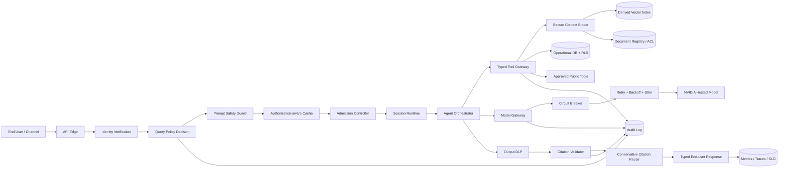
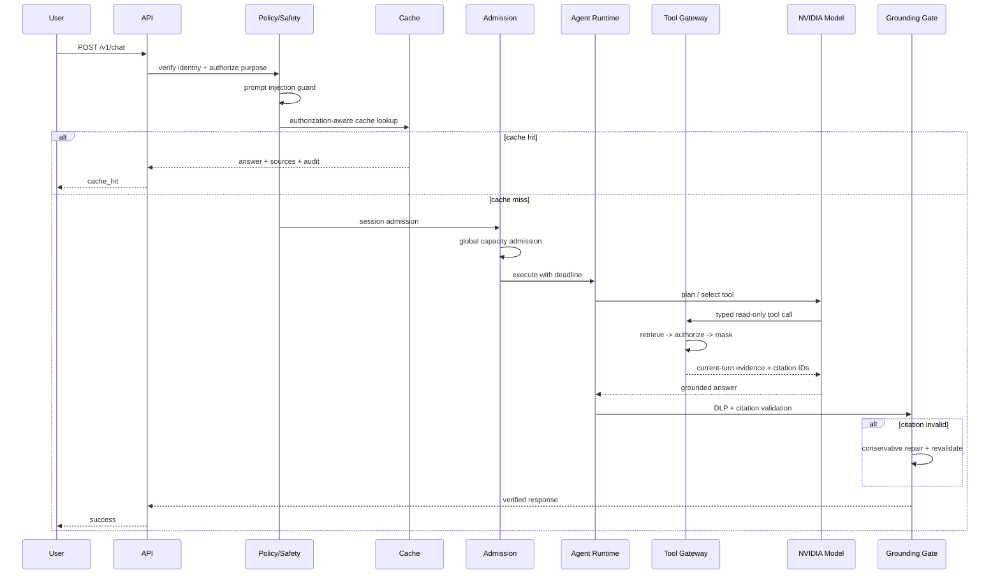

# Architecting Agentic AI Solutions v5 — Production Reference Architecture

## 1. Mục tiêu kiến trúc

Kiến trúc v5 chuyển repo từ một secure Agentic RAG runtime thành một **production-oriented
Agentic AI platform** có bốn postcondition bắt buộc:

1. **Authorized** — mọi source/tool phải được deterministic policy cho phép trước khi dữ liệu đi
   vào model.
2. **Grounded** — enterprise factual answer chỉ được trả khi citation validator xác minh được
   current-turn evidence.
3. **Resilient** — queue, session, provider retry, circuit breaker và timeout có semantics riêng.
4. **Observable** — có latency breakdown, provider trace, tool trace, policy/citation/safety audit.

Kiến trúc không xem LLM là security boundary. LLM chỉ là reasoning/synthesis component nằm giữa
các deterministic controls.

## 2. Các issue được phát hiện qua P01–P10

| Nhóm | Bằng chứng test | Root cause | Mức độ |
|---|---|---|---|
| Citation coverage | P08 trả `valid=false`, coverage `0.50` nhưng HTTP 200 | Validator chưa table-aware; strict postcondition chưa được enforce | High |
| Provider capacity | P04 từng trả NVIDIA capacity exhausted | Chỉ dựa vào SDK retry; chưa có bounded runtime retry/circuit breaker | High |
| Concurrency | P09 concurrency=2 có 1 request 504 sau 10 giây | Queue timeout bị trộn với execution timeout; max inflight=1 | Critical reliability |
| Same-session | P10 planner request 504 trong lúc request khác đang chạy | Session lock wait 10 giây và generic 504 | High |
| Long context | P05 ~76 giây, 2 same-tool calls, 15 sources | Tool loop lặp, context lớn, output dài | High performance |
| Safety semantics | P07 bị block nhưng `policy_audit.status=allowed` | Authorization và safety outcome chưa được tách | Medium |
| Fail-closed latency | P06 ~6.8 giây dù không có tool call | LLM routing vẫn tham gia trước deterministic refusal | Medium |
| End-user verbosity | P10 single-component answer ~9 KB | Không có dynamic answer budget | Medium |
| Observability | Chỉ có `latency_ms` tổng | Không biết timeout ở queue, session, provider hay generation | High operations |

## 3. Target architecture



## 4. Bảy plane của giải pháp

### 4.1 Experience plane

- REST API hiện tại; có thể mở rộng SSE/WebSocket ở deployment thật.
- Stable error codes, `Retry-After`, `X-Request-ID`, `X-Agent-Outcome`.
- Sources/citations hiển thị được cho end user.
- Answer budget theo complexity để tránh câu trả lời 9 KB cho câu hỏi đơn giản.

### 4.2 Identity and policy plane

- JWT/OIDC ở production.
- Tenant, roles, department, clearance, purpose và authorization version.
- Query authorization trước prompt guard/tool execution.
- Document authorization lại sau vector retrieval vì vector similarity không phải ACL.
- PostgreSQL RLS cho operational data.

### 4.3 Agent runtime plane

- Session context được scope bởi tenant + user + auth hash + purpose + answer mode + session.
- `SESSION_CONCURRENCY_POLICY=serialize|reject`.
- Session admission xảy ra trước global capacity admission để không giữ execution slot trong lúc
  chờ một session khác.
- Tool budget giới hạn tổng call và same-tool call.
- ReAct và Plan-and-Execute được coi là strategy branch, không bị trộn thành một lifecycle mâu thuẫn.

### 4.4 Context and data plane

- Source of truth: document registry + database.
- Vector index là derived/rebuildable context store.
- Security trimming, masking và indirect prompt-injection inspection trước model.
- Current-turn evidence là nguồn duy nhất cho enterprise factual claims.
- Cache key chứa authorization, policy/index/prompt/model configuration.

### 4.5 Model gateway plane

- NVIDIA hosted inference.
- Runtime retry chỉ áp dụng transient errors: 429/502/503/504/network timeout.
- Mỗi retry dùng fresh workflow context; evidence của attempt thất bại bị discard.
- Circuit breaker ngăn retry storm khi provider liên tục lỗi.
- Non-transient error không làm provider circuit bị poison.

### 4.6 Trust and quality plane

- Output DLP.
- Table-aware citation parser.
- Strict citation postcondition: `Generate -> Validate -> Conservative repair -> Validate -> Reject`.
- Conservative repair chỉ loại claim không được cite; không tự gắn citation dựa trên lexical guess.
- Blocked/denied/refusal response có `citation_audit.applicable=false`, không báo coverage 100% giả.

### 4.7 Operations plane

- Prometheus metrics cho admission, provider attempts, backoff, circuit state, citation repair.
- Per-request latency breakdown:
  - authorization
  - prompt guard
  - cache lookup
  - session wait
  - capacity wait
  - execution
  - tools
  - provider/backoff
  - DLP
  - citation validation/repair
- Hashed audit event, không ghi raw secrets hoặc raw prompt/answer.

## 5. Request lifecycle



## 6. Admission control và backpressure

### Different sessions

- Global semaphore giới hạn fresh inference requests.
- Queue wait timeout trả `429 CAPACITY_WAIT_TIMEOUT`, không trả generic 504.
- Default local reference: 2 concurrent fresh requests.

### Same session

- `serialize`: giữ thứ tự hội thoại; request sau chờ session lock tối đa 120 giây.
- `reject`: trả `409 SESSION_BUSY`; phù hợp UI khóa nút Send trong lúc turn trước đang chạy.
- Không acquire global slot trước session lock để tránh head-of-line blocking.

### Timeout taxonomy

| Loại | HTTP | Error code |
|---|---:|---|
| Queue/capacity wait | 429 | `CAPACITY_WAIT_TIMEOUT` |
| Same-session busy | 409 | `SESSION_BUSY` |
| Session wait exceeded | 409 | `SESSION_WAIT_TIMEOUT` |
| Provider unavailable | 503 | `NVIDIA_*` |
| Agent execution deadline | 504 | `AGENT_EXECUTION_TIMEOUT` |
| Citation postcondition fail | 422 | `CITATION_VALIDATION_FAILED` |

## 7. Provider resilience

Retry policy:

```text
attempt 1
  -> transient failure
  -> circuit records failure
  -> exponential backoff + jitter
  -> discard attempt evidence/context
attempt 2/3
  -> success: close/reset circuit
  -> final failure: typed 503 + Retry-After
```

Circuit breaker states:

- `closed`: requests allowed.
- `open`: fail fast, protect provider and local queue.
- `half_open`: one probe request after reset period.
- `disabled`: local/testing mode when explicitly configured.

Chỉ retry workflow hiện tại vì tool set của reference repo là read-only. Khi bổ sung write tool, cần
idempotency key, write-ahead audit và compensation/HITL trước khi cho phép retry toàn workflow.

## 8. End-user response contract

Successful response phải cho end user biết:

- kết quả,
- source/citation,
- request outcome,
- cache status,
- policy/citation/safety audit,
- request ID và latency breakdown cho support/debug.

Blocked/denied responses không được mô phỏng answer. Provider/capacity errors phải có retry hint rõ
ràng, không trả một câu chung chung `Agent request timed out`.

## 9. Production deployment topology

```text
WAF / API Gateway
  -> Stateless FastAPI replicas
      -> Redis distributed cache + session coordination
      -> External policy engine / OPA
      -> Managed PostgreSQL + RLS
      -> Managed vector store with metadata pre-filter
      -> NVIDIA model gateway
      -> OpenTelemetry collector
      -> Central audit/SIEM
```

Repo hiện dùng in-process cache/session để local demo có thể chạy độc lập. Scale-out thật phải thay
bằng distributed state; không được giả định sticky session là đủ cho authorization consistency.

## 10. SLO đề xuất

| SLI | Target |
|---|---:|
| Prompt injection block p95 | < 100 ms |
| Exact cache p95 | < 500 ms |
| Fresh simple p95 | < 60 s |
| Multi-corpus p95 | < 75 s |
| Concurrency=2 success | 100% trong controlled test |
| Citation-valid rate strict mode | 100% returned factual answers |
| Cross-tenant leakage | 0 |
| Unauthorized tool execution | 0 |
| Provider transient recovery | >= 95% khi retry budget còn |

## 11. Cách trình bày trong phỏng vấn TA/SA

> Tôi thiết kế LLM như một probabilistic reasoning component, không phải trust boundary. Request đi
> qua identity, deterministic policy, prompt guard, authorization-aware cache và admission control.
> Tool gateway chỉ expose typed read-only capabilities. Retrieved candidates được authorization lại,
> mask và gắn provenance trước khi vào NVIDIA model. Output phải pass DLP và deterministic citation
> postcondition. Reliability được xử lý bằng session/global admission, typed timeout semantics,
> bounded retry, circuit breaker và per-stage telemetry. Vì vậy hệ thống vừa agentic, vừa có thể audit,
> scale và vận hành production.
